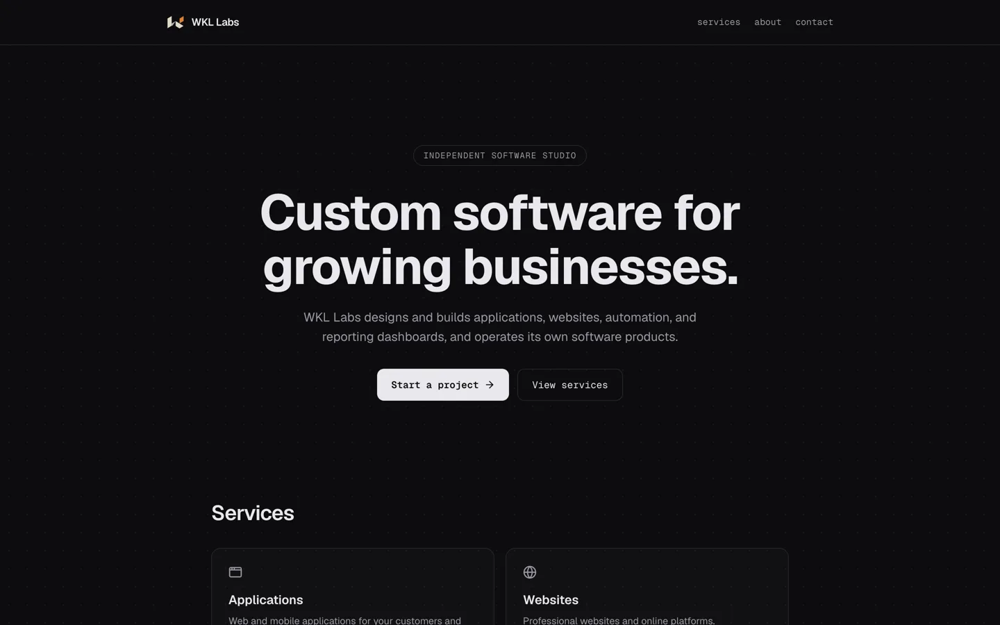
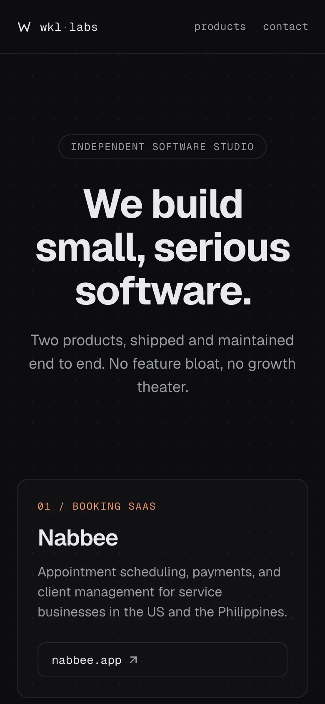

# WKL Labs: studio site



The website for WKL Labs, an independent software studio that builds and maintains small, focused products.

**Live:** [**wkllabs.com**](https://wkllabs.com)



## The problem

A studio running more than one product needs one calm, fast page that explains what it builds and links straight to each live product, without a blog, newsletter or marketing clutter to maintain.

## What I built

- **Single-page studio site:** hero, a product ledger linking to [Nabbee](https://nabbee.app) and [Spell Collector](https://spellcollector.com), an about section and a facts strip.
- **"Precision Dark" design:** dot-grid canvas, monospace accents and a restrained type scale.
- **SEO basics:** generated Open Graph image, `robots.txt` and `sitemap.xml` from the App Router.
- **Custom 404** in the same visual language.

## Tech

Next.js (App Router), React, TypeScript, Tailwind CSS v4, lucide icons, pnpm.

```bash
pnpm install
pnpm dev      # http://localhost:3000
pnpm build
```

## Results and quality

- Live at [wkllabs.com](https://wkllabs.com).
- Static, dependency-light build with no client-side tracking widgets.

## Notes

Source for the studio site is public here. The products it links to are separate, private codebases; see the [Nabbee](https://github.com/williamwkl/nabbee) and [Spell Collector](https://github.com/williamwkl/spellcollector) case studies.
